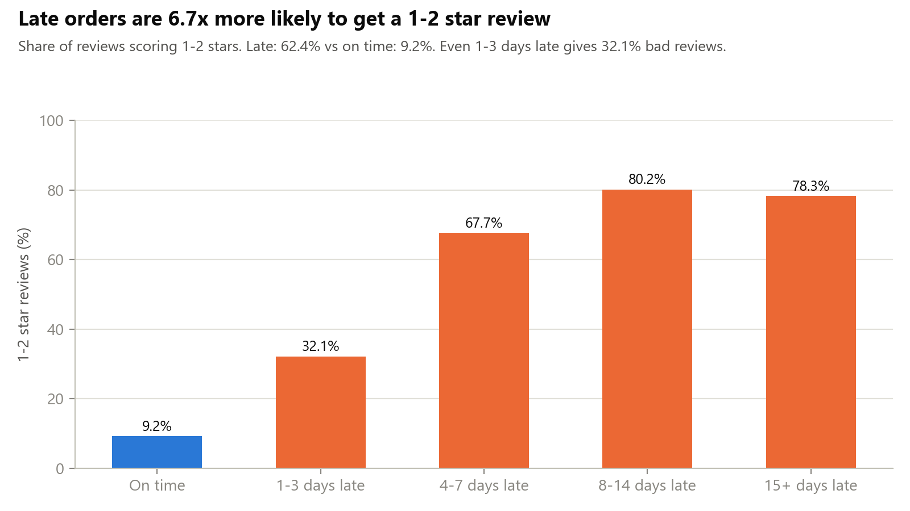
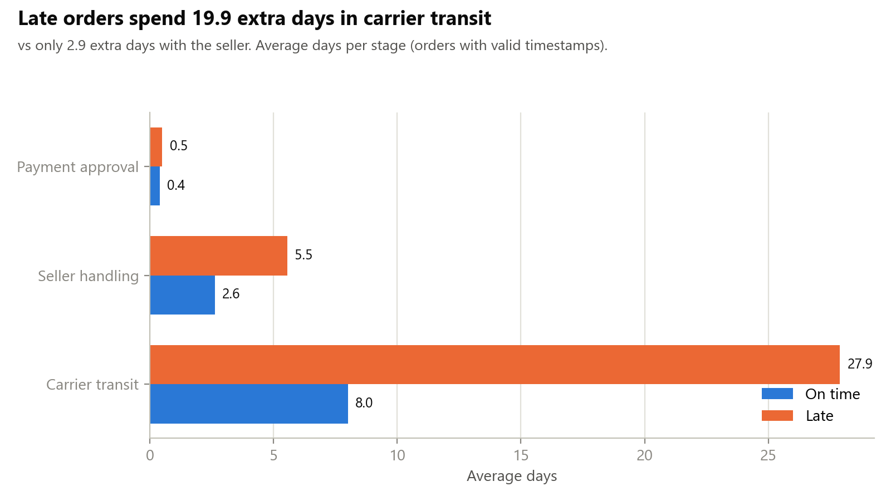
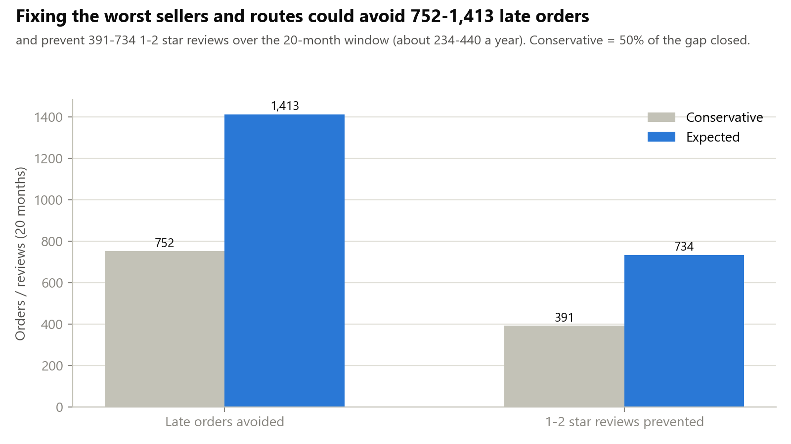

# Delivery Delay Root-Cause Analysis & Customer Satisfaction Improvement (Olist E-Commerce)

A Business Analyst case study by **Priyangi Singh Chouhan**: business problem → stakeholders → requirements → process analysis → data analysis (SQL + Python) → KPIs → recommendations → impact estimate.

### View it live (nothing to install)

| | |
|---|---|
| **Project website** | https://spriyangi232-lab.github.io/olist-ba-project/ |
| **Interactive dashboard** | https://spriyangi232-lab.github.io/olist-ba-project/dashboard/dashboard.html |
| **Case study (PDF)** | https://spriyangi232-lab.github.io/olist-ba-project/docs/case_study.pdf |
| **BRD** | [docs/BRD.md](docs/BRD.md) |
| **Notebook walkthrough** | [notebooks/analysis.ipynb](notebooks/analysis.ipynb) |

## Business problem

Late deliveries drive bad reviews, which hurt repeat purchases and seller ratings. Using 96,203 delivered orders from Olist, a Brazilian marketplace (Jan 2017 to Aug 2018), I set out to answer: **where do delays come from, and what should the business fix first?**

## Key findings

| # | Finding |
|---|---|
| 1 | **6.79% of orders are late** (6,531 orders), on average 10.62 days after the promised date. |
| 2 | **A late order is 6.7× as likely to get a 1-2 star review**: 62.42% vs 9.25%. Even 1-3 days late gives 32.14%. |
| 3 | **The delay happens mostly after the seller hands over the parcel**: late orders spend 19.88 extra days in carrier transit vs 2.93 extra days with the seller, and 72.16% of late orders had a seller who met the handover deadline. |
| 4 | **Lateness comes in peaks**: Feb-Mar 2018 had 14.09% of orders but 34.51% of all late orders; on-time rate fell to 81.04% in March 2018. |
| 5 | **Routes and regions**: São Paulo → Rio de Janeiro produced 1,157 late orders (14.01% late). North-East states are worst by rate: Alagoas (AL) is late 21.46% of the time. |
| 6 | **Sellers**: missing the handover deadline raises the late rate from 5.32% to 20.98%. 125 sellers create 1,061 more late orders than an average seller would. |
| 7 | **The delivery promise is mis-set**: 78.87% of orders arrive 7+ days early, yet states with the least buffer have the most late orders (r = -0.71). |
| 8 | **Impact**: bringing the worst sellers and 5 worst routes to the platform average would avoid **752 to 1,413 late orders** and **391 to 734 1-2 star reviews** over 20 months. |

Product category is not a main driver (most categories sit at 5-8% late). Repeat purchase is lower after a late first order (1.62% vs 2.19%) but only 2.15% of customers ever buy again, so that result is directional.

<p align="center">
  
  
</p>
<p align="center">
  
</p>

## Recommendations

1. **Weekly seller scorecard** ranked by excess late orders, with an alert 24 hours before the shipping limit date. *(Quick win)*
2. **Re-set delivery estimates** for the five lowest-buffer states (AL, MA, SE, ES, CE). *(Quick win)*
3. **Route-level service levels** with carriers for the worst routes (SP → RJ, SP → BA, SP → CE, PR → RJ).
4. **Peak-season capacity plan** agreed with carriers before Black Friday and other known peaks.
5. **Proactive messages** to customers whose order is at risk of being late.

Details, the impact-vs-effort table and a 30/60/90-day roadmap are in the [case study](docs/case_study.pdf).

## Approach

| Step | What I did | Output |
|---|---|---|
| 1. Define | Business problem, stakeholders, SMART objectives, scope, functional and non-functional requirements | [BRD](docs/BRD.md) |
| 2. Map the process | AS-IS and TO-BE order fulfilment swimlanes with pain points and fixes | [Process flows](docs/process_flows.md) |
| 3. Clean and validate | Loaded 8 CSVs, applied written definitions, flagged data-quality issues, built a SQLite database | [Validation report](docs/data_validation_report.md) |
| 4. Analyse | 15 SQL queries, one per business question | [sql/analysis.sql](sql/analysis.sql), [notebook](notebooks/analysis.ipynb) |
| 5. Estimate impact | What-if scenario with written assumptions and a conservative / expected range | [src/03_impact.py](src/03_impact.py) |
| 6. Communicate | 10 charts, an offline interactive dashboard, a 12-page case study, a Power BI rebuild guide | [dashboard](dashboard/dashboard.html), [case study](docs/case_study.pdf), [Power BI guide](docs/powerbi_guide.md) |

**Definitions:** late = delivered date after the estimated date (dates only); bad review = latest review score 1-2; seller SLA breach = parcel handed to the carrier after the shipping limit date. Every headline number is stored in [results/metrics.json](results/metrics.json) and all documents are generated from it or checked against it.

**Tools:** Python (pandas, sqlite3, matplotlib, plotly, python-docx), SQL (SQLite, window functions, CTEs), Mermaid, Power BI (guide).

## Repository structure

```
olist-ba-project/
├── index.html                 project website (GitHub Pages home page)
├── run_all.py                 rebuilds everything with one command
├── run_all.bat                same, double-click on Windows
├── data/raw/                  the 8 Olist CSVs used (included, see data/README.md)
├── data/processed/            cleaned CSVs + olist.db (created by run_all.py)
├── src/
│   ├── 01_clean.py            load, clean, validate, build SQLite
│   ├── 02_run_sql.py          run every query, save tables, write metrics
│   ├── 03_impact.py           impact scenario (conservative / expected)
│   ├── 04_charts.py           10 report charts
│   ├── 05_dashboard.py        offline interactive dashboard
│   ├── 06_case_study.py       case study .docx and .pdf
│   ├── 07_website.py          project website (index.html)
│   └── 08_check_numbers.py    QA: checks every number in the documents
├── sql/analysis.sql           15 business queries, each labelled with its question
├── notebooks/analysis.ipynb   question → query → result → chart → insight
├── results/
│   ├── metrics.json           every headline number
│   ├── tables/                query outputs (CSV)
│   └── charts/                PNG charts
├── dashboard/dashboard.html   self-contained Plotly dashboard (works offline)
├── docs/                      BRD, process flows, case study, Power BI guide,
│                              validation report, resume and interview notes
├── requirements.txt
└── README.md
```

## Run it yourself

The data is already in the repository, so there is nothing to download. With Python 3.10+ installed:

```bash
git clone https://github.com/spriyangi232-lab/olist-ba-project.git
```
```bash
cd olist-ba-project
```
```bash
python run_all.py
```

`run_all.py` installs any missing packages, runs the eight scripts in order, re-runs the notebook and finishes with the number check. It takes about a minute. On Windows you can also double-click `run_all.bat`.

The PDF step uses Microsoft Word through docx2pdf. On a computer without Word, every other output is still built and `docs/case_study.docx` can be exported to PDF by hand.

## Data source and licence

Data: [Brazilian E-Commerce Public Dataset by Olist](https://www.kaggle.com/datasets/olistbr/brazilian-ecommerce), Kaggle, licensed under [CC BY-NC-SA 4.0](https://creativecommons.org/licenses/by-nc-sa/4.0/). The 8 CSV files used are included unchanged in `data/raw/` with credit to Olist, under the same licence; the unused geolocation file is left out. This is a non-commercial portfolio project and is not affiliated with Olist.
