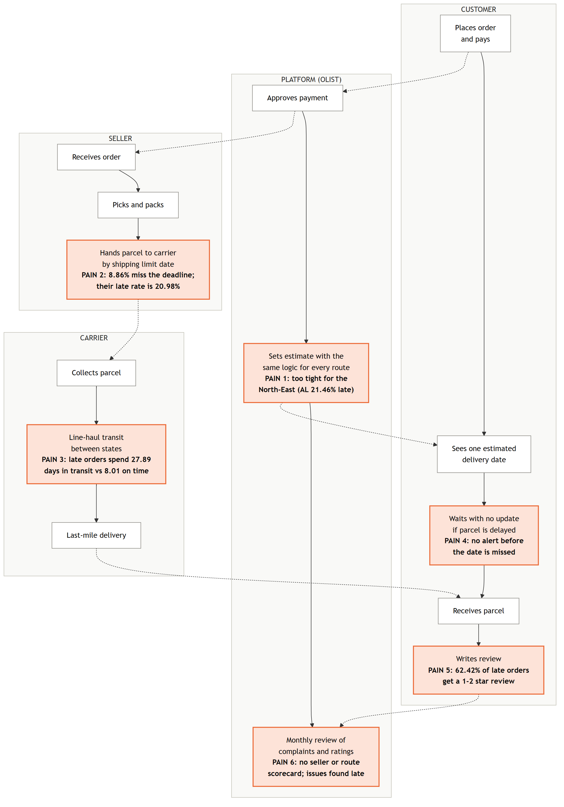
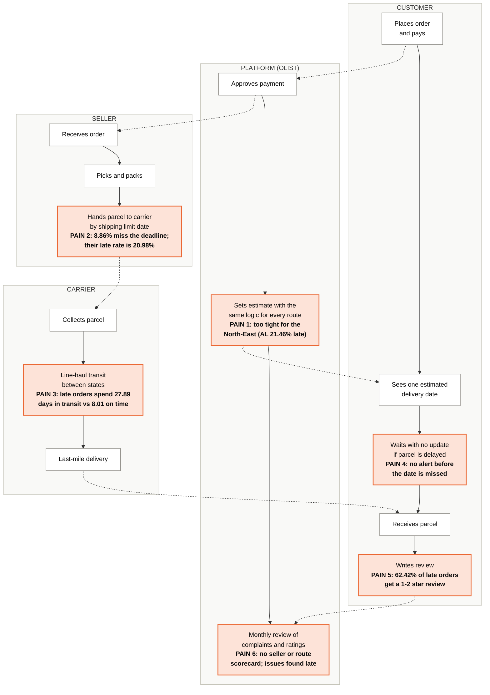
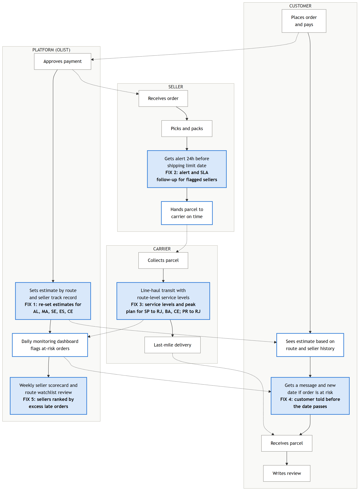
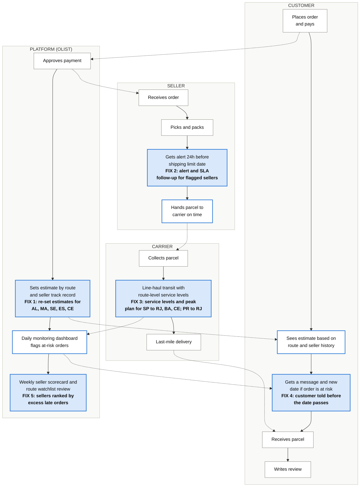

# Process Flows: Order Fulfilment AS-IS and TO-BE

| | |
|---|---|
| **Project** | Delivery Delay Root-Cause Analysis & Customer Satisfaction Improvement (Olist E-Commerce) |
| **Author** | Priyangi Singh Chouhan |
| **Version** | 1.0 |
| **Date** | 18 November 2026 |
| **Status** | Draft for stakeholder review |

All figures come from `results/metrics.json`. The diagrams are written in Mermaid; the sources are in `docs/diagrams/*.mmd` and the rendered images are `docs/diagrams/as_is.png` and `docs/diagrams/to_be.png`.

---

## 1. How to read the diagrams

- There are four lanes: **Customer**, **Platform (Olist)**, **Seller** and **Carrier**.
- Solid arrows are steps inside one lane. Dotted arrows are hand-offs between lanes.
- On the AS-IS flow, orange boxes are steps with a pain point (PAIN 1-6).
- On the TO-BE flow, blue-filled boxes carry an improvement (FIX 1-5) and blue-outlined boxes are new or changed steps.

## 2. AS-IS order fulfilment

### Pain points

| ID | Step | Pain point | Evidence |
|---|---|---|---|
| PAIN 1 | Platform sets the estimate | The same logic is used for every route, so the promise is too tight for the North-East and too loose elsewhere | AL: 8.6 days buffer and 21.46% late; 78.87% of all orders arrive 7+ days early |
| PAIN 2 | Seller hands over to the carrier | Some sellers miss the shipping limit date | 8.86% of handovers are late; those orders are late 20.98% of the time vs 5.32% |
| PAIN 3 | Carrier line-haul transit | Long and uneven transit between states | Late orders spend 27.89 days in transit vs 8.01 for on-time orders |
| PAIN 4 | Customer waits | No warning before the promised date is missed | No at-risk flag exists in the current process |
| PAIN 5 | Customer writes review | A broken promise turns into a bad review | 62.42% of late orders get 1-2 stars vs 9.25% of on-time orders |
| PAIN 6 | Platform reviews performance | Only a monthly look at complaints; no seller or route view | 125 sellers create 1,061 excess late orders without being flagged |

## 3. TO-BE order fulfilment

### Improvements

| ID | Change | Fixes | Owner |
|---|---|---|---|
| FIX 1 | Set the delivery estimate by route and seller track record; first re-set the five lowest-buffer states (AL, MA, SE, ES, CE) | PAIN 1 | Product Manager |
| FIX 2 | Alert sellers 24 hours before the shipping limit date and follow up with sellers who breach it often | PAIN 2 | Seller Operations Manager |
| FIX 3 | Agree route-level service levels and a peak-season capacity plan with carriers for SP to RJ, SP to BA, SP to CE and PR to RJ | PAIN 3 | Logistics Partner Manager |
| FIX 4 | Flag at-risk orders daily and send the customer a message and a new date before the promise is missed | PAIN 4, PAIN 5 | CX Lead |
| FIX 5 | Weekly seller scorecard ranked by excess late orders and a route watchlist, both in the monitoring dashboard | PAIN 6 | BI Lead, Seller Ops |

## 4. What changes for each lane

| Lane | AS-IS | TO-BE |
|---|---|---|
| Customer | Sees one fixed date and gets no update | Sees a date that fits their route; is told early if the order is at risk |
| Platform | Same estimate logic everywhere; monthly review of complaints | Route-based estimate; daily at-risk monitoring; weekly scorecard and watchlist |
| Seller | Learns about a missed deadline after the fact | Gets an alert before the deadline; is ranked fairly on excess late orders |
| Carrier | No route-level targets | Route-level service levels and a peak capacity plan |
